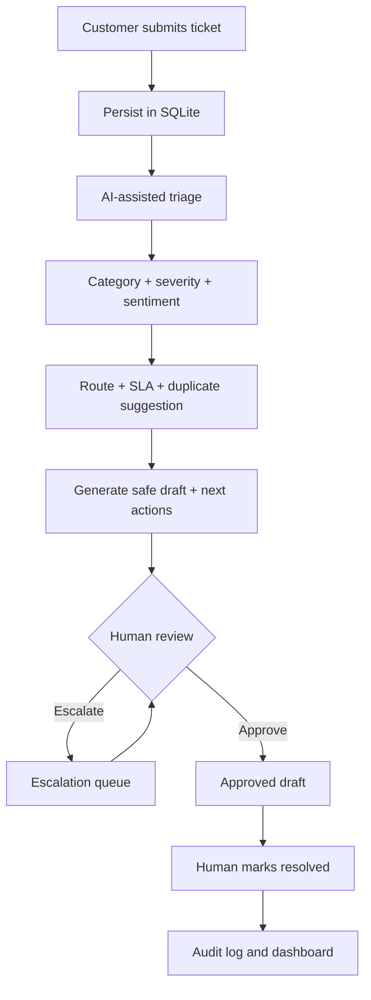

# FlowDesk AI Support Ticket Triage & Resolution Agent

A **runnable, end-to-end PM portfolio prototype** for a fictional B2B SaaS platform. It demonstrates structured ticket intake, explainable triage, severity assessment, routing, duplicate suggestions, first-response SLA risk, draft responses, human approval, resolution status, audit logging, dashboards and an evaluation benchmark.

> All 100 seeded tickets and organizations are synthetic. This application does not send emails, change accounts, process refunds or close external tickets.

## Run locally

Use **Python 3.10+**:

```bash
cd flowdesk-ai-support
python -m venv .venv
# macOS/Linux: source .venv/bin/activate
# Windows: .venv\Scripts\activate
pip install -r requirements.txt
streamlit run app.py
```

Open the URL printed by Streamlit (normally `http://localhost:8501`). The first run creates `flowdesk.db` from `data/tickets.csv`. No API key is needed.

## Optional OpenAI language enhancement

Set the following environment variables before starting Streamlit:

```bash
export USE_LLM=1
export OPENAI_API_KEY=your_key_here
export OPENAI_MODEL=gpt-4o-mini
```

On Windows PowerShell, use `$env:USE_LLM="1"` and `$env:OPENAI_API_KEY="..."`. Optional LLM refinement only changes concise summaries and low-risk draft wording. **Classification, severity, safety gates, and routing remain explainable rules-based decisions**. Security or billing drafts remain fixed safety-reviewed templates. An API failure falls back to rules. LLM responses must be reviewed before sending. API usage may incur charges.

## Demo walkthrough (5–8 minutes)

1. **Critical outage**: In Ticket inbox choose `TKT-001` → Run AI triage. Inspect P0 priority, engineering routing, SLA alert and human approval requirement.
2. **Security risk**: Open `TKT-003` → triage. Observe Security routing, protected draft and mandatory review.
3. **Duplicate**: Triage `TKT-006`, review possible link to `TKT-001`. Duplicate suggestions are non-destructive, with an explicit review step.
4. **Easy request**: Triage `TKT-008` for low-priority routing and a safer account-settings response.
5. **Full lifecycle**: Edit draft → Approve → Mark as resolved. Inspect Audit trail.
6. **Create your own**: Submit a ticket from the form → open it in the inbox → triage and review.
7. **PM metrics**: Open Operations dashboard and AI benchmark; show measurable outcomes and error cases.

## Workflow



## Evaluation and limitations

- `data/tickets.csv` includes `gold_category`, `gold_priority`, and `incident_group` columns. **These are not fed into inference**.
- `evaluation.py` reports accuracy on 100 synthetic authored examples, and surfaces mistakes for targeted iteration. This is a transparent demo benchmark rather than production validation.
- Rule-based categorization is brittle, priority labels are heuristics, duplicate matching uses lexical similarity (not learned semantic embeddings), and confidence is heuristic (not calibrated).
- SLA policy in `engine.py`: P0 15 min, P1 60 min, P2 4 hours, P3 24 hours (fictional policy; first-response only). Synthetic historical timestamps can appear breached even though no live SLA clock has been integrated.
- Security incidents and charge disputes require human intervention; the app **never actually sends** its replies.
- Authentication/authorization, concurrency protections, a production incident workflow, robust redaction, full observability, and regulatory controls would be necessary before any real customer deployment.

## Architecture

- `app.py` — Streamlit interface / workflow
- `engine.py` — explainable classification, severity, duplicate and SLA logic; optional LLM draft enhancement
- `storage.py` — SQLite records, review workflow and events
- `seed.py` — reproducible dataset generator
- `data/tickets.csv` — 100 synthetic tickets with evaluation labels
- `evaluation.py` — offline baseline benchmark
- `tests/` — behavior and safety gate tests

## Product management artifacts

**Persona:** Customer support agent wants to make fast, consistent routing decisions without missing serious incidents.

**Problem statement:** Support teams spend time manually inspecting tickets and triaging repeat incidents; wrong severity causes delays and unnecessary escalations.

**Hypothesis:** AI-assisted triage with a reviewer in control can cut median time-to-first-approved-response while retaining high recall on high-impact/security incidents.

**North-star metric (pilot):** Median minutes from ticket creation to first approved response.

**Input / guardrail metrics:** Category macro-F1; routing accuracy; P0/P1 and security recall; duplicate precision; human edit rate; false high-priority escalations; cost and latency per triage; SLA breach rate.

**Out of scope:** Autonomous refund issuing, account changes, external messaging, any action that requires authorization.

**Next phases:** Human-labeled evaluation set, semantic deduplication, role-based access control, knowledge-base grounding with citations, CSAT measurement, sandbox helpdesk integration, model cost tracking, and A/B testing against current manual process.

## Test

```bash
pytest -q
python evaluation.py
```

The application automatically bootstraps its dataset. To restart the demo from a clean state, stop Streamlit and delete the generated `flowdesk.db` file. Do not delete the CSV.

## Sample resume entry (only after validating these claims personally)

> Built a ticket-triage and human-in-the-loop support workflow prototype with explainable priority prediction, smart routing, duplicate suggestions, SLA flags, response drafting and operational dashboards; designed a 100-ticket synthetic evaluation benchmark to assess classification quality and identify failure modes.
